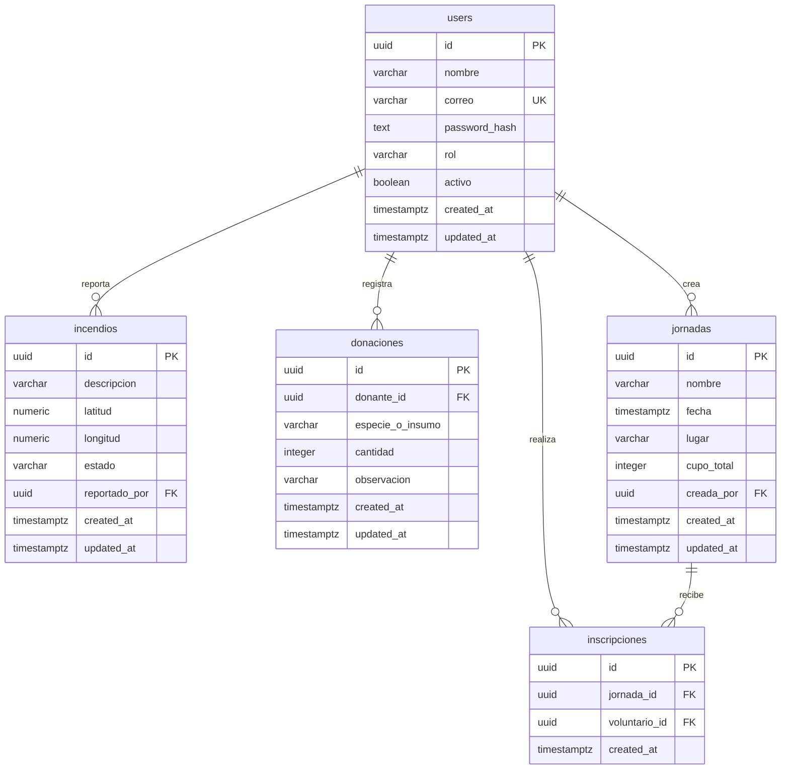

# Modelo relacional de ReForest

Tarea: HT00-T00-API. Fuente: secciones 7 y 10.1 de PLAN_DESARROLLO_REFOREST.txt.

Este documento define el diseño previo a la implementación. No crea tablas ni migraciones. El detalle de columnas está en [diccionario-datos.md](diccionario-datos.md).

## Convenciones

Tablas y columnas en snake_case, con los nombres establecidos por el plan. Todas las claves primarias y foráneas usan UUID, generados por la aplicación. Los UUID se representan como cadenas en JSON. Las fechas usan TIMESTAMPTZ; la aplicación escribe y devuelve UTC y la interfaz convierte a la zona del usuario. Las coordenadas usan NUMERIC con seis decimales.

## Diagrama entidad-relación

## Relaciones y borrado

| Padre | Hijo y clave foránea | Cardinalidad | ON DELETE |
|---|---|---|---|
| users | incendios.reportado_por | Un usuario tiene cero o muchos reportes; cada reporte tiene un usuario. | RESTRICT |
| users | donaciones.donante_id | Un usuario tiene cero o muchas donaciones; cada donación tiene un donante. | RESTRICT |
| users | jornadas.creada_por | Un usuario crea cero o muchas jornadas; cada jornada tiene un creador. | RESTRICT |
| users | inscripciones.voluntario_id | Un usuario tiene cero o muchas inscripciones; cada inscripción tiene un voluntario. | RESTRICT |
| jornadas | inscripciones.jornada_id | Una jornada tiene cero o muchas inscripciones; cada inscripción tiene una jornada. | RESTRICT |

Todas las claves foráneas son obligatorias. No hay borrado en cascada: una fila referenciada no puede eliminarse. `users.activo` permite desactivar usuarios conservando su trazabilidad. La relación de participación entre users y jornadas es muchos a muchos y se resuelve con inscripciones. La relación creada_por identifica al creador, no a los participantes.

## Integridad y reglas del servicio

PostgreSQL garantiza claves, valores únicos, longitudes, valores permitidos y rangos mediante las restricciones del diccionario. FastAPI repite las validaciones para dar errores comprensibles y aplica autenticación y permisos: una clave foránea no comprueba roles.

- Registro: normalizar correo con recorte y minúsculas antes de guardarlo; rechazar duplicados con 409. El registro público nunca asigna ADMINISTRADOR. Guardar únicamente password_hash y excluirlo de respuestas y logs.
- Sesión: usar JWT con expiración; no persistir tokens en estas tablas. El servicio deberá rechazar usuarios inactivos.
- Incendios: reportado_por procede del usuario autenticado. La API establece ACTIVO al crear. Solo ADMINISTRADOR actualiza estado; la lista filtra por estado y pagina resultados.
- Donaciones: ENTIDAD registra; ADMINISTRADOR consulta lista y detalle. El servicio valida cantidad entera positiva y el rol del donante.
- Jornadas: solo ADMINISTRADOR crea; creada_por procede del usuario autenticado. Los usuarios consultan jornadas y disponibilidad.
- Inscripciones: solo VOLUNTARIO se inscribe; voluntario_id procede de la sesión. UNIQUE(jornada_id, voluntario_id) impide repetir una inscripción incluso con solicitudes simultáneas.
- Cupo disponible: cupo_total menos el número de inscripciones persistidas. El modelo del plan no tiene estado de inscripción: cada fila representa una inscripción confirmada. No se almacena el cupo disponible.

### Control de cupo concurrente

La futura implementación de HU03 debe iniciar una transacción, bloquear la fila de la jornada, comprobar duplicados y contar inscripciones, verificar el cupo, insertar y confirmar. Todas las operaciones de inscripción deben usar el mismo bloqueo. La restricción única protege contra duplicados; por sí sola no impide superar el cupo. Un rechazo no debe dejar cambios parciales. HU03 verificará concurrencia contra PostgreSQL real.

## Trazabilidad con el backlog

| Historia | Contratos relacionados | Creación del esquema |
|---|---|---|
| HU05 / HU06 | POST /api/v1/auth/register; POST /api/v1/auth/login; GET /api/v1/auth/me | HU05-T03-API: users |
| HU01 / HU02 / HU08 | POST y GET /api/v1/incendios; GET /api/v1/incendios/{id}; PATCH /api/v1/incendios/{id}/estado | HU01-T12-API: incendios |
| HU04 | POST y GET /api/v1/donaciones; GET /api/v1/donaciones/{id} | HU04-T23-API: donaciones |
| HU09 | POST y GET /api/v1/jornadas; GET /api/v1/jornadas/{id} | HU09-T27-API: jornadas |
| HU03 | POST /api/v1/jornadas/{jornada_id}/inscripciones; GET /api/v1/me/inscripciones | HU03-T30-API: inscripciones |

Las tablas se implementan incrementalmente. HU09 precede a inscripciones; el cálculo definitivo de disponibilidad se integra cuando HU03 crea esa tabla. Cada cambio posterior debe actualizar ambos documentos, incluir migración Alembic y pruebas; revisar el SQL y verificar upgrade y downgrade antes de entregar.

## Decisiones pendientes antes de sus implementaciones

- HU05: entrada password de 8 a 128 caracteres, sin recorte y rechazando solo espacios; correo normalizado y roles públicos CIUDADANO, VOLUNTARIO y ENTIDAD. Hash Argon2id. Pendiente para HU06: mecanismo de creación del administrador.
- HU01/HU02: precisar si únicamente CIUDADANO reporta y qué consultas requieren sesión; definir JSON de listas, errores y el campo fecha frente a created_at.
- HU08: el plan admite tres estados pero no define transiciones entre ellos.
- HU04: el contrato solicita donante, mientras el modelo usa donante_id. Acordar su significado; se propone derivar el donante de la sesión, pendiente de aprobación del contrato.
- HU09/HU03: concretar disponibles=true, política de fechas pasadas y respuestas de duplicado o falta de cupo. No se añaden estados, cancelaciones ni reglas de transición ausentes del plan.

## Validación documental PV-00

| Pregunta del plan | Respuesta verificable en el diseño |
|---|---|
| ¿Qué usuario reportó un incendio? | incendios.reportado_por referencia users.id. |
| ¿Qué entidad registró una donación? | donaciones.donante_id referencia users.id; FastAPI verifica ENTIDAD. |
| ¿Quién creó una jornada? | jornadas.creada_por referencia users.id; FastAPI verifica ADMINISTRADOR. |
| ¿Qué voluntarios se inscribieron? | Consultar inscripciones por jornada_id y relacionar voluntario_id con users.id. |
| ¿Por qué no puede repetirse una inscripción? | La combinación jornada_id y voluntario_id tiene una restricción UNIQUE. |

Caso de error esperado: intentar repetir la misma combinación de jornada y voluntario debe ser rechazado por la base cuando se implemente la migración. En HT00 se revisa el diseño; no se afirma haber ejecutado pruebas SQL ni de integración. El estudiante debe poder explicar las relaciones uno a muchos y muchos a muchos antes de aprobar PV-00.
